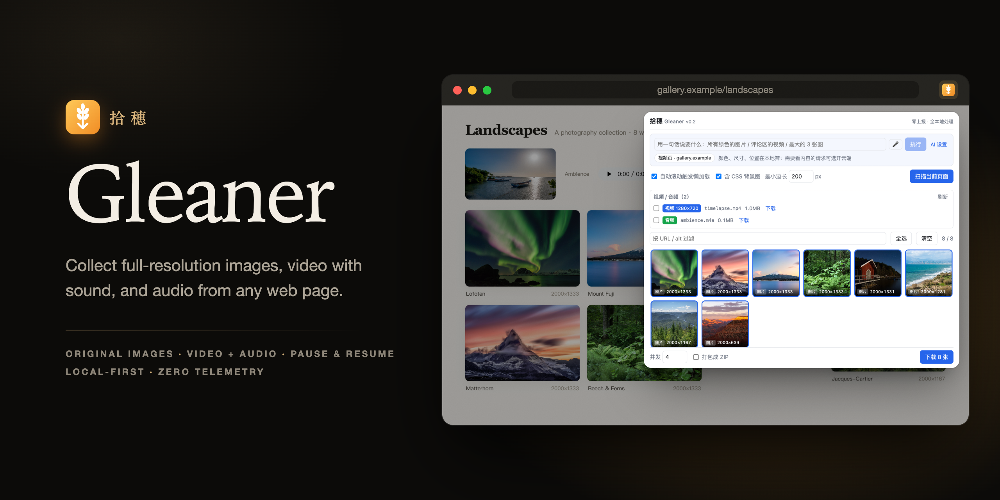
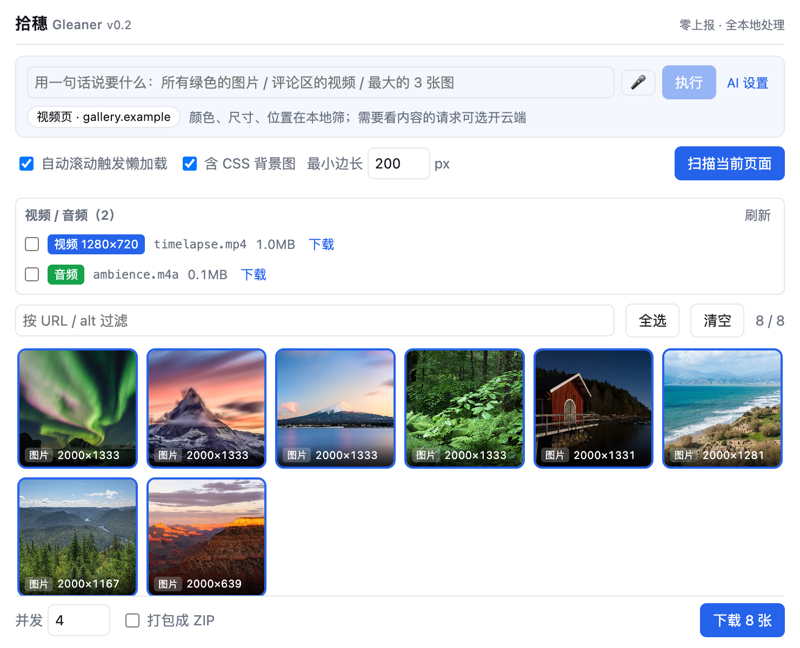
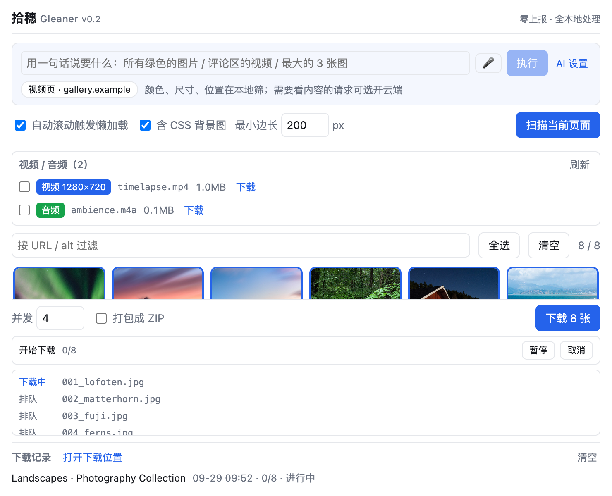
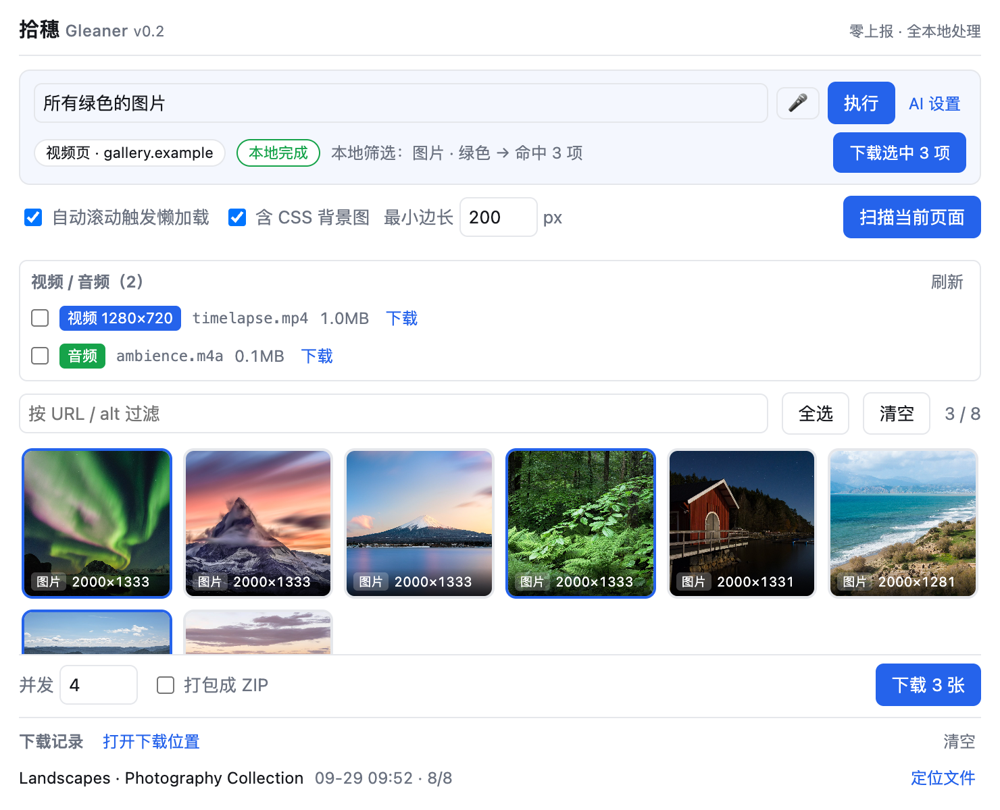
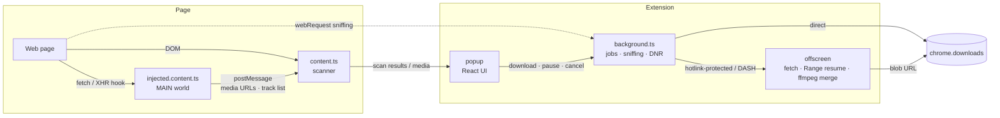

<div align="center">



# Gleaner · 拾穗

**Collect full-resolution images, video with sound, and audio from any web page.**<br>
Zero telemetry. Apart from the optional cloud assistant and voice input, everything runs on your own machine.

[](LICENSE)

[](https://github.com/ssssssanjiu/gleaner/actions/workflows/build.yml)


**English** · [简体中文](README.zh-CN.md)

[Install](#install) · [Features](#features) · [How it works](#how-it-works) · [Testing](#testing) · [Development](#development) · [Contributing](CONTRIBUTING.md)

</div>

> The name comes from Millet's painting *The Gleaners* — picking up, one by one, the originals scattered across a web page.
>
> **Interface language:** the extension UI is currently Simplified Chinese only.

---

## Screenshots

<table>
<tr>
<td width="50%"><br><b>Scan</b> — every image is labelled with the resolution of the original file; video and audio are listed separately.</td>
<td width="50%"><br><b>Download</b> — pause / resume / cancel, per-file status, and a history with "reveal in folder".</td>
</tr>
<tr>
<td width="50%"><br><b>Pick by description</b> — "all the green images" is matched locally from pixel colours; nothing is uploaded.</td>
<td width="50%">

**About the screenshots:** they are captured automatically by `npm run docs:shots`, which loads the real extension into a real Chrome. The demo page uses CC0 photos from Wikimedia Commons (authors listed in [docs/demo/CREDITS.md](docs/demo/CREDITS.md)); its short video was generated from one of those photos with ffmpeg.

</td>
</tr>
</table>

## Features

- 🖼 **Original-quality images.** Built-in site rules rewrite thumbnail URLs to the original file (popular e-commerce, social and image-hosting CDNs, plus common OSS / Qiniu / COS processing parameters). The label on each card is the resolution of the **original**: after scanning, Gleaner fetches only the first bytes of each file (an HTTP Range request, usually under 128 KB) and reads the real dimensions from the header.
- 🔍 **Thorough scanning.** ``, `srcset` (parsed per the HTML spec), `<picture>`, CSS backgrounds, links to images and ten common lazy-load attributes; the page is auto-scrolled first to trigger lazy loading. Multiple sizes of the same image produce a single card.
- 🎬 **Video and audio.** Media is captured three ways: network sniffing, a read-only page hook, and a DOM scan. When a site streams picture and sound as separate tracks (DASH), Gleaner pairs them and merges them locally into **one MP4 with sound** using a bundled ffmpeg.wasm. Where the player exposes its track list, Gleaner picks the most compatible codec (**H.264**) rather than the AV1 track the player chose — AV1 files won't open in QuickTime on M1/M2 Macs. If the primary CDN fails it falls back to backup CDNs, and it estimates file size from bitrate × duration to pick the highest quality that fits.
- ⏯ **Works like Chrome's download manager.** Real pause (the network request is aborted, bytes already received are kept), resume via HTTP Range (verified against a real CDN: the resumed file is byte-for-byte the same size as an uninterrupted download), and cancel. Downloads keep running when the popup is closed; the toolbar badge shows progress; starting another download **adds** to the list instead of replacing the running one; each batch gets its own history entry with one-click "reveal in Finder / Explorer".
- 🛡 **Hotlink protection.** A per-host Referer is added through `declarativeNetRequest`; the rules only match requests that don't belong to any tab (mainly the extension's own fetches), so the pages you browse are untouched. Blocked direct downloads are retried through the extension's own fetch channel, and if an upgraded original still can't be fetched, Gleaner falls back to the image that was actually shown on the page.
- 🤖 **Pick by description.** "All the green images", "videos in the comments", "the 3 largest images" are resolved locally. Requests that need to understand content ("photos with a cat") can optionally go to Claude — off by default, bring your own API key. Voice input is supported.
- 📦 **Batch downloads.** Adjustable concurrency, a folder per page title, or a single ZIP (entry extensions come from the file signature, and HTML error pages are never packed as images). File names are sanitised with rules verified against real Chrome, so emoji, zero-width characters, `~` and trailing dots never make a download fail.
- 🔒 **Zero telemetry.** No analytics, tracking or remote config. The extension only makes two kinds of requests: fetching the media itself (downloads, size probes, re-fetching thumbnails to read colours for local matching), and the cloud assistant if you turn it on.

## Install

1. Download the latest `gleaner-*-chrome.zip` from [Releases](../../releases) and unzip it to a folder you won't delete.
2. Open `chrome://extensions` and switch on **Developer mode** (top right). Other Chromium browsers such as Edge should work the same way via `edge://extensions`, but haven't been tested individually.
3. Click **Load unpacked** and choose the unzipped folder.
4. Pin the Gleaner (wheat) icon to the toolbar. On any page, click it → **扫描当前页面** (Scan this page).

> For streaming video, play it for a few seconds first, then open Gleaner and click **刷新** (Refresh).

To update, overwrite the same folder and click ↻ on Gleaner's card in `chrome://extensions`.

**From source:** `npm ci && npm run build` (Node ≥ 22.12), then choose `.output/chrome-mv3` in step 3.

## How it works



<details>
<summary><b>Why downloaded videos sometimes wouldn't play</b></summary>

Many video sites offer every quality in three codecs: **H.264, HEVC and AV1**. In Chrome the player usually picks AV1 — and QuickTime on M1/M2 Macs can't open AV1, so the downloaded file shows "cannot be opened" (in a September 2026 spot check, 2 of 4 popular videos were AV1).

Gleaner doesn't simply follow the player. Where the page exposes the player's own track list (a DASH manifest delivered as JSON — currently implemented for Bilibili's `playurl` format, embedded in the page or fetched by the player), every track carries its codec, resolution and signed URL. Selection order: avoid AV1 → fit within the size limit → highest resolution → prefer H.264 at equal resolution.

If only HEVC is available: HEVC is often packaged as `hev1`, which QuickTime refuses; Gleaner rewrites those 4 bytes to `hvc1` on download (equivalent to `ffmpeg -c copy -tag:v hvc1`).

</details>

<details>
<summary><b>Hotlink protection: why not just use chrome.downloads</b></summary>

Verified in practice: `declarativeNetRequest` Referer rules **do not apply to requests made by `chrome.downloads`**, and `downloads.download` forbids setting a Referer header. So protected resources are fetched by an offscreen document instead (an extension page with host permissions, not subject to CORS); a DNR rule adds the Referer, the bytes are assembled into a blob inside the offscreen document, and only the blob URL is handed to `downloads`.

Rules carry `tabIds: [-1]`, so they only match requests that don't belong to any tab (mainly the extension's own fetches; a site's own Service Worker hitting the same CDN would in theory match too). Requests made by the tabs you browse are never rewritten.

</details>

<details>
<summary><b>Bytes never cross a message boundary</b></summary>

An `ArrayBuffer` sent through `runtime.sendMessage` is JSON-serialised to `{}` — which means a 0-byte file on disk (a bug this project actually shipped once). Fetching, merging and blob creation therefore all happen inside the offscreen document, and only a blob URL is passed to the `downloads` API. The e2e suite asserts the byte size and the presence of an audio track for every file written to disk.

</details>

<details>
<summary><b>Download semantics (aligned with Chrome's download manager)</b></summary>

- **The background owns the jobs; the popup is just a view.** Closing the popup or switching tabs doesn't affect downloads; reopening restores progress and the file list.
- **Pause is per item.** Direct downloads map to `chrome.downloads.pause`; whole-file fetches in the offscreen document are genuinely aborted, the received bytes are kept in memory, and resume continues with `Range` (starting over automatically if the server doesn't support it or the file changed). Items already being merged locally aren't interrupted — they finish and are saved.
- **Starting a download while paused:** new items start normally; paused items stay paused.
- **Service Worker recycled:** Chrome may stop the MV3 background at any time. The job ledger is persisted item by item in `storage.local`; on wake-up, fetches started by the previous instance whose results can no longer be delivered are re-queued and re-dispatched, and the offscreen document hands over the in-flight fetch for the same URL, resuming with Range.
- **Reconciliation:** when the popup opens, `downloads.search` corrects any missed events, using exactly the same handling as live events, so an item being retried is never mistaken for a failure.
- **Toolbar badge:** remaining count while running (blue), ❚❚ when paused (yellow), ✓ (green) or ! (red) when finished.

</details>

<details>
<summary><b>The assistant: local first, cloud optional</b></summary>

| You say | Handled by | Sent to the cloud? |
|---|---|---|
| all the green images / blue and yellow ones | Local: re-fetch thumbnails, bucket pixels by HSL | No |
| large images / wider than 1000px / landscape / portrait / 1080p | Local: dimensions and orientation | No |
| videos in the comments / sidebar images / footer | Local: the page section recorded for each item during the scan | No (see exception below) |
| the second video / the 3 largest / the first 5 | Local: order and sorting | No |
| photos with a cat / product shots on white / that funny video | **Cloud** (if enabled) | Yes |

Intent parsing is rule-based (`src/core/agent/intent.ts`): each recognised fragment is removed, and only what remains with content words goes to the cloud.
**One exception:** if the section you named (e.g. "comments") isn't found on the page and you have the cloud assistant on, the request and the candidates are sent to the cloud to judge by content; with the cloud off, you just get a local hint.

The cloud assistant is off by default. Turn it on in **AI 设置** (AI settings), enter your own Anthropic API key and pick a model; the key is stored only on your machine. What gets sent:

1. your sentence;
2. a page summary: title, the URL's host and path, meta description, og:type, up to 15 headings, and for each candidate its size / byte size / alt / page section / file name (**no body text, no original images**);
3. up to 3 numbered contact sheets (up to 48 thumbnails each).

The model has exactly one strict tool, `select_media`, and can only answer with the numbers it selected. Networks in mainland China / Hong Kong need a proxy; the error message says so.

Voice input uses Chrome's built-in Web Speech API (audio goes to Google's speech service — not local; this is stated in the settings).

</details>

## Permissions

| Permission | Used for |
|---|---|
| `downloads` | The only way files are written to disk |
| Content scripts (via `host_permissions`) | Two scripts load on every page: ① a **read-only** hook on `fetch` / `XHR` in the page world (including iframes) that only records URLs that look like media, plus a look at `<video>/<audio>` every 3 seconds; ② the scanner, which receives what ① recorded and only walks the page when you press Scan in the popup. Neither modifies page content or sends data anywhere |
| `activeTab` / `scripting` | Injects the scanner once into pages that were already open before the extension was installed |
| `storage` | Job ledger, download history and settings (local only) |
| `webRequest` | Observation-only sniffing of real media URLs (never blocks or modifies) |
| `offscreen` | A DOM context for fetching, merging video and audio, and building ZIPs |
| `declarativeNetRequestWithHostAccess` | Adds a Referer to the extension's own requests (hotlink protection) |
| `host_permissions: <all_urls>` | Media can come from any CDN |

## Testing

This project has been burned by "all tests pass, real use breaks", so verification is layered. Requirements: Node ≥ 22.12; the real-browser commands need Chrome installed (the macOS path is used by default; elsewhere set `CHROME=<path to chrome>`).

| Command | What it does | Result |
|---|---|---|
| `npm test` | Unit + integration tests: the real background / offscreen / content modules run against a mock that faithfully reproduces Chrome semantics (JSON-serialised messages, storage returning copies, DNR duplicate-ID errors, no network access, Service Worker cold starts with a fresh module instance) | 367 / 367 |
| `npm run e2e` | Puppeteer drives **real Chrome** with the built extension: scanning, files on disk, pause/resume, auto-resume after the Service Worker is stopped, DASH video (AV1 → H.264), original-size probing, the assistant | 97 / 97 |
| `OG_OUT_DIR=.output-popup npx wxt build && node e2e/popup-layout.mjs` | The real 600 px popup keeps every control visible and status messages aren't overwritten | 71 / 71 |
| `node selftest/scan-real-chrome.mjs` | Scanner behaviour in real Chrome at 1x and 2x (originals, srcset, picture) | 12 / 12 |
| `node e2e/filename-probe.mjs` | Hundreds of tricky file names fed to real Chrome's `downloads.download` to verify the sanitiser | 499 / 499 |
| `npm run live-bili` | **A real video site** (macOS only): open a real video page → download → check playability with AVFoundation (what QuickTime uses). Tests 2 videos by default (`VIDEOS=…` to choose); `PAUSE_TEST=1` pauses and resumes mid-download and records the states (not auto-asserted) | 5 videos tested so far, all playable |
| `npm run selftest` | Builds a dependency-free `selftest.html` that verifies each image rule live in any browser, including phones | — |

Every bug fix starts with a test that reproduces it, and the fix is then temporarily reverted to confirm the test fails — so tests can't quietly "pass" without checking anything.

## Development

```bash
npm install
npm run dev          # opens Chrome with the extension (persistent profile)
npm run build        # output in .output/chrome-mv3
npm run zip          # build a zip
npm test             # unit + integration
npm run e2e          # end-to-end in real Chrome
npm run docs:shots   # re-capture the README screenshots and banner
```

Requires Node ≥ 22.12. After `npm install`, `scripts/prepare-public.mjs` runs automatically: it copies ffmpeg.wasm from `@ffmpeg/core` and generates the license files bundled into the extension.
Release packages are built by GitHub Actions in a clean environment (pushing a `v*` tag publishes a Release automatically). A local `npm run zip:firefox` puts every non-hidden file in the working tree into sources.zip — don't publish from a directory that contains anything else.

<details>
<summary>Project layout</summary>

```
src/
├── core/
│   ├── rules.ts        ← site rules for original images (PRs welcome — see CONTRIBUTING.md)
│   ├── scanner.ts      ← DOM scanner (srcset / picture / lazy loading / backgrounds)
│   ├── media.ts        ← media detection, DASH track pairing, cross-CDN dedupe, HLS segment filtering
│   ├── bili.ts         ← DASH track-list selection: prefer H.264, pair audio, fit within the size limit
│   ├── imagesize.ts    ← read dimensions from file headers (JPEG / PNG / GIF / WebP / AVIF / HEIC / BMP)
│   ├── fmp4.ts         ← hev1 → hvc1 byte patch
│   ├── ffmpeg-mux.ts   ← merge video + audio tracks with ffmpeg.wasm
│   ├── filename.ts     ← file-name sanitiser (rules verified in real Chrome)
│   ├── zip.ts / queue.ts / page-hooks.ts / page-support.ts
│   └── agent/          ← the assistant (pure logic, fully unit-tested; claude.ts is the only file that talks to the network)
├── public/
│   ├── ffmpeg/         ← copied from @ffmpeg/core on install (not in git; MV3 forbids remote code)
│   ├── licenses/       ← generated on install: full license texts bundled into the extension
│   └── icon/
└── entrypoints/
    ├── background.ts   ← jobs, reconciliation, sniffing, DNR, original-size probing
    ├── offscreen/      ← fetching (Range resume, backup CDNs), merging, blob creation
    ├── content.ts / injected.content.ts
    ├── popup/          ← React UI
    └── mic/            ← microphone permission page
tests/                  ← node:test (real API response shapes with fake signatures, generated images, ffmpeg-generated media)
e2e/                    ← real-Chrome end-to-end, live video-site check, file-name probe
licenses/third-party/   ← license texts of every ffmpeg.wasm component
```

</details>

## Known limitations

- **Firefox** runs on MV2 without `declarativeNetRequest` or offscreen documents, so the Referer rules, DASH video merging and hotlink retries are unavailable.
- **m3u8 / HLS streams** aren't supported yet: they're marked "m3u8·暂不支持" and can't be selected; live `.ts` segments aren't listed individually.
- **600 MB limit for whole-file fetches** (peak memory for fetching + merging is roughly 3–4× the file size). Gleaner picks the highest quality that fits and says so in the list when nothing fits.
- Live testing so far covered logged-out viewing (480P); higher qualities go through the same code path but haven't each been tested live. Backup-CDN failover on mainland-China networks has only been verified in a simulated environment.
- Only the top-level document is scanned; images inside iframes aren't handled yet.

## Roadmap

- [x] v0.1 Batch image downloads + site rule system
- [x] v0.2 Download manager semantics, direct media, DASH merging, the assistant, real pause & resume, original-size probing
- [ ] v0.3 HLS (parse m3u8, fetch segments, mux into MP4)
- [ ] v0.4 Floating button, context menu, drag-to-download

## Things this project will not do

- **No DRM decryption.** There is no decryption capability and PRs adding one won't be accepted. Encrypted content won't play even if downloaded.
- **No CAPTCHA solving, no bypassing login walls.**
- Use it for personal backup and fair use only. Downloaded content belongs to its creators; obtain permission before any commercial use and respect each site's terms of service.

> All site names and trademarks mentioned belong to their respective owners. This project is not affiliated with, endorsed or sponsored by any of them; they are mentioned only to describe compatibility.

## License

The code is released under the [MIT](LICENSE) license. Release packages also include third-party components such as FFmpeg (ffmpeg.wasm, GPL-2.0-or-later); see [THIRD_PARTY_NOTICES.md](THIRD_PARTY_NOTICES.md) for licenses and where to obtain the source.
