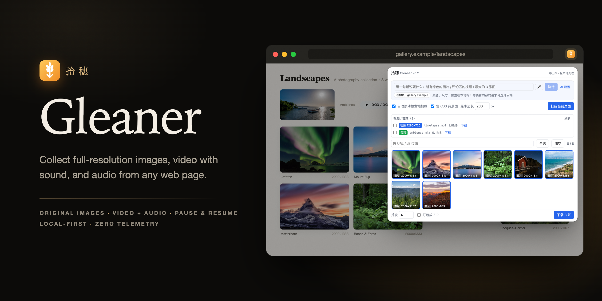
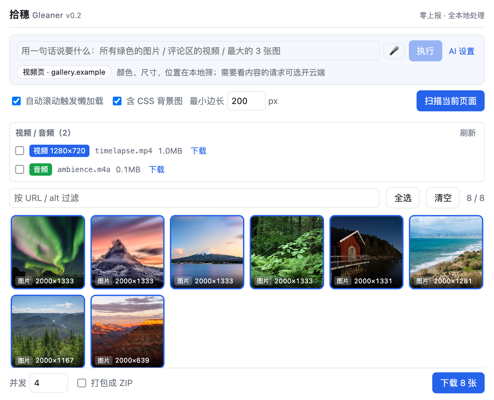
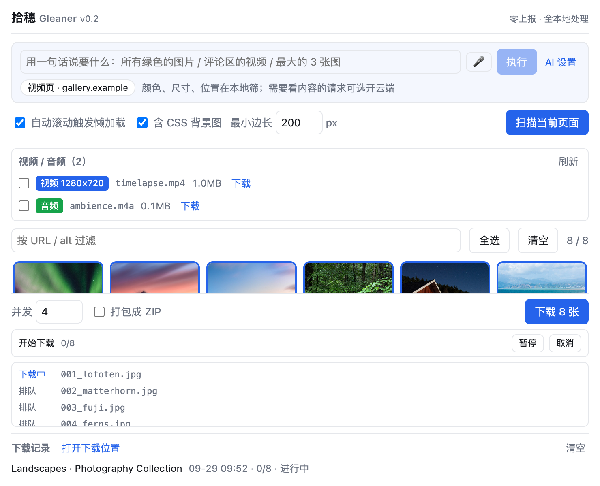
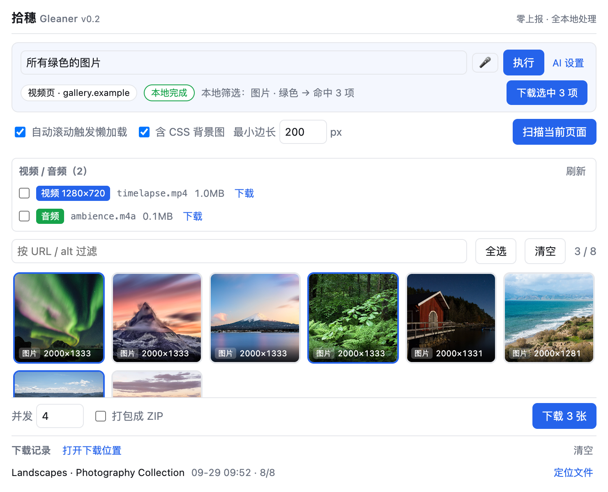
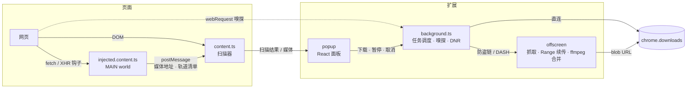

<div align="center">



# 拾穗 Gleaner

**一键拾取网页里的原图、视频和音频。**<br>
零上报；除了你主动开启的云端助手和语音输入，下载和处理都在你的电脑上完成。

[](LICENSE)

[](https://github.com/ssssssanjiu/gleaner/actions/workflows/build.yml)


[English](README.md) · **简体中文**

[安装](#安装) · [功能](#功能) · [原理](#它是怎么做到的) · [验证](#测试与验证) · [开发](#开发) · [贡献规则](CONTRIBUTING.md)

</div>

> 名字取自米勒的名画《拾穗者》——把网页上散落的原图、视频、音频，一颗一颗捡回来。

---

## 截图

<table>
<tr>
<td width="50%"><br><b>扫描</b>：每张图标的是原图的分辨率；视频、音频单独列出</td>
<td width="50%"><br><b>下载</b>：暂停 / 继续 / 取消、逐个文件的状态、下载记录一键定位文件</td>
</tr>
<tr>
<td width="50%"><br><b>一句话挑图</b>：「所有绿色的图片」在本机按像素判色，不上传</td>
<td width="50%">

**截图说明**：截图由 `npm run docs:shots` 在真 Chrome 里加载真扩展自动拍摄。演示页用的是 Wikimedia Commons 上的 CC0 照片（作者见 [docs/demo/CREDITS.md](docs/demo/CREDITS.md)），短视频由其中一张照片经 ffmpeg 生成。

</td>
</tr>
</table>

## 功能

- 🖼 **原图自动升级**：内置站点规则，把缩略图地址改写成原图（常见电商、社交、图床 CDN，以及阿里云 OSS / 七牛 / 腾讯 COS 处理参数）。卡片上标的是**原图**的分辨率：扫描后只拉文件开头（Range 请求，一般 128KB 以内）读出真实宽高。
- 🔍 **扫得全**：`` / `srcset`（按 HTML 规范解析）/ `<picture>` / CSS 背景图 / 指向图片的链接 / 十种懒加载属性；扫描前自动滚动触发懒加载。同一张图的多个尺寸只出一张卡片。
- 🎬 **视频和音频**：网络嗅探 + 页面钩子 + DOM 扫描三路捕获。画面和声音分开传的网站（DASH），自动配对，用内置 ffmpeg.wasm 在本地合成**一个带声音的 MP4**；播放器公开了轨道清单时，挑兼容性最好的 **H.264**，而不是播放器自己选的 AV1（M1/M2 Mac 的 QuickTime 打不开 AV1）。主线路失败自动换备用线路；按码率 × 时长估体积，自动挑放得进上限的最高清晰度。
- ⏯ **像 Chrome 下载管理器一样**：真暂停（中止网络请求，已下的字节留着）、继续（HTTP Range **断点续传**，真实 CDN 实测续传后与一口气下完的文件逐字节一致）、取消；关掉弹窗照常下载；图标角标显示进度；再点下载会**追加**进下载列表而不是顶掉正在下的；每批一条下载记录，一键在访达 / 资源管理器里选中文件。
- 🛡 **防盗链**：用 `declarativeNetRequest` 按域名补 Referer（规则只作用于不属于任何标签页的请求——主要是扩展自己的抓取——不会改写你正在浏览的网页的请求）；直连被拒自动改走扩展自己的抓取通道重试；原图地址实在下不了时，退回页面上能显示的那张。
- 🤖 **一句话挑素材**：「所有绿色的图片」「评论区的视频」「最大的 3 张图」在本机筛完；「有猫的图」这类要看懂内容的请求可选接入 Claude（默认关闭、自带 Key）。支持语音输入。
- 📦 **批量下载**：可调并发、按页面标题建文件夹，或一键打包 ZIP（包内扩展名按文件头判断，网页响应不会冒充图片）。文件名清洗规则在真 Chrome 里实测过，emoji、零宽字符、`~`、结尾的点都不会让下载失败。
- 🔒 **零上报**：没有统计、埋点、远程配置。扩展发出的请求只有两类：拉取素材本身（下载、探测原图尺寸、本地判色时重新拉缩略图读像素），以及你自己开启的云端助手。

## 安装

1. 到 [Releases](../../releases) 下载最新的 `gleaner-*-chrome.zip`，解压到一个**不会被删掉**的文件夹。
2. Chrome 打开 `chrome://extensions`，右上角打开「开发者模式」（Edge 等 Chromium 浏览器理论上同样可用，地址是 `edge://extensions`，未逐一实测）。
3. 点「加载已解压的扩展程序」，选择刚才解压出来的文件夹。
4. 把工具栏上的拾穗（麦穗）图标固定出来。打开任意网页 → 点图标 → 「扫描当前页面」。

> 想下在线播放的视频：先在页面上播放几秒，再打开拾穗点「刷新」。

更新时覆盖同一个文件夹，然后在 `chrome://extensions` 里点拾穗卡片上的 ↻。

**从源码安装**：`npm ci && npm run build`（需要 Node ≥ 22.12），然后在第 3 步选择 `.output/chrome-mv3`。

## 它是怎么做到的



<details>
<summary><b>为什么下下来的视频有时打不开</b></summary>

很多视频网站每个清晰度都同时提供 **H.264 / HEVC / AV1** 三种编码。播放器在 Chrome 里通常选 AV1——而 M1/M2 Mac 的 QuickTime 不支持 AV1，下下来就是「无法打开」（2026-09 抽查热门视频，4 个里 2 个是 AV1）。

拾穗不跟着播放器下。页面公开了播放器自己的轨道清单时（以 JSON 下发的 DASH 清单，目前实现了 Bilibili 的 `playurl` 格式：内嵌在页面里，或由播放器请求），每条轨都写明了编码、分辨率和带签名的地址。挑选顺序：不要 AV1 → 放得进体积上限 → 清晰度最高 → 同清晰度 H.264 优先。

如果只拿得到 HEVC：HEVC 常封装成 `hev1`，QuickTime 只认 `hvc1`，下载时会自动把这 4 个字节改掉（等价于 `ffmpeg -c copy -tag:v hvc1`）。

</details>

<details>
<summary><b>防盗链：为什么不直接用 chrome.downloads</b></summary>

实测确认：`declarativeNetRequest` 的 Referer 规则**对 `chrome.downloads` 发出的请求不生效**，而 `downloads.download` 的 `headers` 又禁止设置 Referer。所以防盗链资源改由 offscreen 页面抓取（扩展页 + host 权限，不受 CORS 限制），DNR 规则给它补上 Referer，字节在 offscreen 里拼成 blob 再交给 `downloads` 落盘。

规则带 `tabIds: [-1]`，只作用于不属于任何标签页的请求（主要是扩展自己的抓取；网站自己的 Service Worker 发往同一 CDN 的请求理论上也会匹配），不会改写你正在浏览的标签页里的请求。

</details>

<details>
<summary><b>字节从不跨消息边界</b></summary>

`ArrayBuffer` 经 `runtime.sendMessage` 会被 JSON 序列化成 `{}`，落盘就是 0 字节（真实踩过）。所以抓取、合并、生成 blob 全在 offscreen 一个上下文里完成，只把 blob URL 交给 `downloads` API。e2e 对每个落盘文件都断言字节数和音频轨存在。

</details>

<details>
<summary><b>下载任务语义（对齐 Chrome 下载管理器）</b></summary>

- **任务归后台所有，弹窗只是视图**：关闭弹窗、切换标签页不影响下载，重开弹窗恢复进度和文件列表。
- **暂停是逐项的**：直连下载映射到 `chrome.downloads.pause`；offscreen 里的整包抓取会被真正中止，已抓的字节留在内存，继续时带 `Range` 从断点续抓（服务器不支持或文件变了会自动从头来）。已经在本地合并的项不打断，合完直接保存。
- **暂停中又点了下载**：新项照常开始，暂停的保持暂停。
- **Service Worker 被回收**：MV3 后台随时可能被 Chrome 回收。任务账本逐项存在 `storage.local`；唤醒时，上一个实例发起、结果已经收不到的抓取会退回排队并重新派发，offscreen 里同一地址的旧抓取被接管、带 Range 续上。
- **对账**：弹窗打开时用 `downloads.search` 修正丢失的事件；和实时事件走同一套处理，不会把正在重试的项误判失败。
- **图标角标**：进行中显示剩余数量（蓝），暂停 ❚❚（黄），完成 ✓（绿）或 !（红）。

</details>

<details>
<summary><b>AI 助手：本地优先，云端可选</b></summary>

| 你的话 | 谁来做 | 发给云端？ |
|---|---|---|
| 所有绿色的图片 / 蓝色和黄色的 | 本地：重新拉取缩略图，像素做 HSL 分桶 | 否 |
| 大图 / 大于 1000px / 横图 / 竖图 / 1080p | 本地：尺寸、方向 | 否 |
| 评论区的视频 / 侧栏的图 / 页脚 | 本地：扫描时记下每个素材所在区块 | 否（见下方例外） |
| 第二个视频 / 最大的 3 张 / 前 5 张 | 本地：序号、排序 | 否 |
| 有猫的图 / 白底产品图 / 那个搞笑的视频 | **云端**（需开启） | 是 |

意图解析是规则驱动的（`src/core/agent/intent.ts`）：逐类识别并抠掉已理解的片段，剩下还带实词的才交给云端。
**一个例外**：你说的区块（比如「评论区」）在页面上没识别出来、且你已开启云端时，会把这次请求连同候选素材交给云端按内容判断；没开云端就只在本地提示。

云端部分默认关闭：在「AI 设置」里打开、填自己的 Anthropic API Key、选模型。Key 只存在本机。发送的内容是：

1. 你的这句话；
2. 页面摘要：标题、网址的域名和路径、meta 描述、og:type、最多 15 个小标题，以及每个候选素材的尺寸 / 体积 / alt / 所在区块 / 文件名（**不含正文段落，不含原图**）；
3. 最多 3 张编号联络表（每张最多 48 格缩略图）。

模型只有一个 strict 工具 `select_media`，只能回「选了哪些编号」。大陆 / 港澳网络需要代理，报错会直接说明。

语音输入用 Chrome 内置的 Web Speech API（音频经 Google 语音服务，不是纯本地，设置里写明了）。

</details>

## 权限说明

| 权限 | 用途 |
|---|---|
| `downloads` | 唯一的落盘方式 |
| 内容脚本（随 `host_permissions` 生效） | 每个网页打开时自动加载两段脚本：① 页面世界里给 `fetch` / `XHR` 挂**只读**钩子（含 iframe），只记下看起来是音视频的地址和播放器的轨道清单，每 3 秒看一眼 `<video>/<audio>`；② 扫描脚本，接收①记下的地址，收到弹窗的「扫描」才遍历页面。都不修改页面内容、不外发数据 |
| `activeTab` / `scripting` | 扩展装好之前就已打开的页面，点「扫描」时补注入一次扫描脚本 |
| `storage` | 下载任务账本、下载记录、偏好设置（都只在本机） |
| `webRequest` | 观察模式嗅探页面的视频 / 音频真实地址（不拦截、不修改） |
| `offscreen` | 在有 DOM 的上下文里抓取、合并音视频、打 ZIP |
| `declarativeNetRequestWithHostAccess` | 给扩展自己的请求补 Referer（防盗链） |
| `host_permissions: <all_urls>` | 素材可能来自任意 CDN 域名 |

## 测试与验证

这个项目吃过「测试全过、真用就坏」的亏，所以验证分了好几层。环境要求：Node ≥ 22.12；真浏览器相关的命令需要本机装有 Chrome（默认找 macOS 的安装路径，其它系统用环境变量 `CHROME=<chrome 可执行文件路径>` 指定）。

| 命令 | 做什么 | 当前结果 |
|---|---|---|
| `npm test` | 单元 + 集成测试：真实的 background / offscreen / content 模块跑在一个忠实模拟 Chrome 语义的 mock 上（消息 JSON 序列化、storage 返回副本、DNR 重复 id 报错、外网隔离、Service Worker 冷启动用全新模块实例） | 367 / 367 |
| `npm run e2e` | puppeteer 驱动**真 Chrome** 加载构建好的扩展：扫描、落盘、暂停续传、SW 被停后自动续抓、DASH 视频（AV1 → H.264）、原图尺寸探测、AI 助手 | 97 / 97 |
| `OG_OUT_DIR=.output-popup npx wxt build && node e2e/popup-layout.mjs` | 真弹窗 600px 高度内控件都可见、各种状态文字不被覆盖 | 71 / 71 |
| `node selftest/scan-real-chrome.mjs` | 扫描器在真 Chrome（1x / 2x 屏）上的原图、srcset、picture 行为 | 12 / 12 |
| `node e2e/filename-probe.mjs` | 几百个刁钻文件名交给真 Chrome 的 `downloads.download`，核对清洗规则 | 499 / 499 |
| `npm run live-bili` | **真实视频网站**（仅 macOS）：打开真实视频页 → 下载 → 用 AVFoundation（QuickTime 同款）核对能否播放。默认测 2 个视频，可用 `VIDEOS=…` 指定；`PAUSE_TEST=1` 会中途暂停再继续，记录前后状态（不自动判定） | 累计实测 5 个视频全部可播放 |
| `npm run selftest` | 生成零依赖的 `selftest.html`，任何浏览器（含手机）打开就能逐条验证原图规则 | — |

每修一个 bug，都会先写一个能复现它的测试，再临时撤掉修复确认测试会失败——防止测试自己「假装通过」。

## 开发

```bash
npm install
npm run dev          # 自动打开带扩展的 Chrome（持久 profile，可当日常测试浏览器）
npm run build        # 产物在 .output/chrome-mv3
npm run zip          # 出 zip
npm test             # 单元 + 集成
npm run e2e          # 真 Chrome 端到端
npm run docs:shots   # 重拍 README 截图和横幅
```

需要 Node ≥ 22.12。`npm install` 之后会自动运行 `scripts/prepare-public.mjs`：从 `@ffmpeg/core` 复制 ffmpeg.wasm，并生成打进扩展包的许可证文件。
发布用的安装包由 GitHub Actions 在干净环境里构建（打 `v*` 标签即自动发 Release）；本地跑 `npm run zip:firefox` 生成的 sources.zip 会收进工作区里所有非隐藏文件，别在混有其它文件的目录里用它发布。

<details>
<summary>项目结构</summary>

```
src/
├── core/
│   ├── rules.ts        ← 站点原图规则表（最欢迎 PR，见 CONTRIBUTING.md）
│   ├── scanner.ts      ← DOM 扫描器（srcset / picture / 懒加载 / 背景图）
│   ├── media.ts        ← 音视频识别、DASH 轨配对、跨 CDN 去重、HLS 分段过滤
│   ├── bili.ts         ← DASH 轨道清单：挑 H.264、配声音、按体积选清晰度
│   ├── imagesize.ts    ← 从文件头读宽高（JPEG / PNG / GIF / WebP / AVIF / HEIC / BMP）
│   ├── fmp4.ts         ← hev1 → hvc1 字节修正
│   ├── ffmpeg-mux.ts   ← ffmpeg.wasm 合并画面轨 + 声音轨
│   ├── filename.ts     ← 文件名清洗（规则来自真 Chrome 实测）
│   ├── zip.ts / queue.ts / page-hooks.ts / page-support.ts
│   └── agent/          ← AI 助手（纯逻辑，全部可单测；claude.ts 是唯一会联网的文件）
├── public/
│   ├── ffmpeg/         ← 装依赖时从 @ffmpeg/core 复制（不在 git 里；MV3 禁止远程加载代码，只能打进包）
│   ├── licenses/       ← 装依赖时生成：打进扩展包的许可证全文
│   └── icon/
└── entrypoints/
    ├── background.ts   ← 任务调度、对账、嗅探、DNR、原图尺寸探测
    ├── offscreen/      ← 抓取（Range 续传、备用线路）、合并、生成 blob
    ├── content.ts / injected.content.ts
    ├── popup/          ← React 面板
    └── mic/            ← 麦克风授权页
tests/                  ← node:test（真实接口响应结构（签名已换成假值）、程序生成的图片、ffmpeg 生成的音视频）
e2e/                    ← 真 Chrome 端到端、真实视频网站实测、文件名探针
licenses/third-party/   ← ffmpeg.wasm 各组件的许可证原文
```

</details>

## 已知限制

- **Firefox 版**走 MV2，没有 `declarativeNetRequest` 和 offscreen：防盗链补 Referer、DASH 视频合并、防盗链重试都不可用。
- **m3u8 / HLS 流**暂不支持：列表里标「m3u8·暂不支持」且不能勾选；直播的 `.ts` 分段不单独列出。
- **整包抓取上限 600MB**（抓取 + 合并的内存峰值约是文件的 3~4 倍）。会自动挑放得下的清晰度；放不下时列表里直接说明。
- 真实视频网站的实测只覆盖了未登录（480P）；更高清晰度走同一条路径，但没有逐一实测。大陆网络下的备用线路切换只在本地模拟环境验证过。
- 扫描只覆盖主文档，iframe 里的图暂不处理。

## Roadmap

- [x] v0.1 图片批量 + 站点规则系统
- [x] v0.2 下载任务语义、直链音视频、DASH 合并、AI 助手、真暂停与断点续传、原图尺寸探测
- [ ] v0.3 HLS（解析 m3u8，分片拉取后 mux 成 MP4）
- [ ] v0.4 悬浮按钮、右键菜单、拖拽下载

## 明确不做的事

- **不做 DRM 解密**：不包含任何解密能力，也不会接受这类 PR。加密内容即使下载下来也无法播放。
- **不破解验证码、不绕过登录墙**。
- 请只用于个人备份与合理使用。下载的内容版权归原作者，商用前请自行取得授权，并遵守各网站的服务条款。

> 文中提到的网站名称和商标归各自所有者。本项目与这些网站及其运营方没有任何关联，也未获其认可或赞助；提到它们只是为了说明兼容性。

## License

本项目代码以 [MIT](LICENSE) 许可发布。发布的扩展安装包里还带有 FFmpeg（ffmpeg.wasm，GPL-2.0-or-later）等第三方组件，许可证与源代码获取方式见 [THIRD_PARTY_NOTICES.md](THIRD_PARTY_NOTICES.md)。
